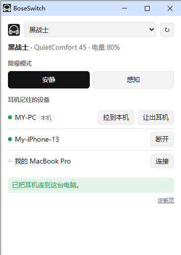
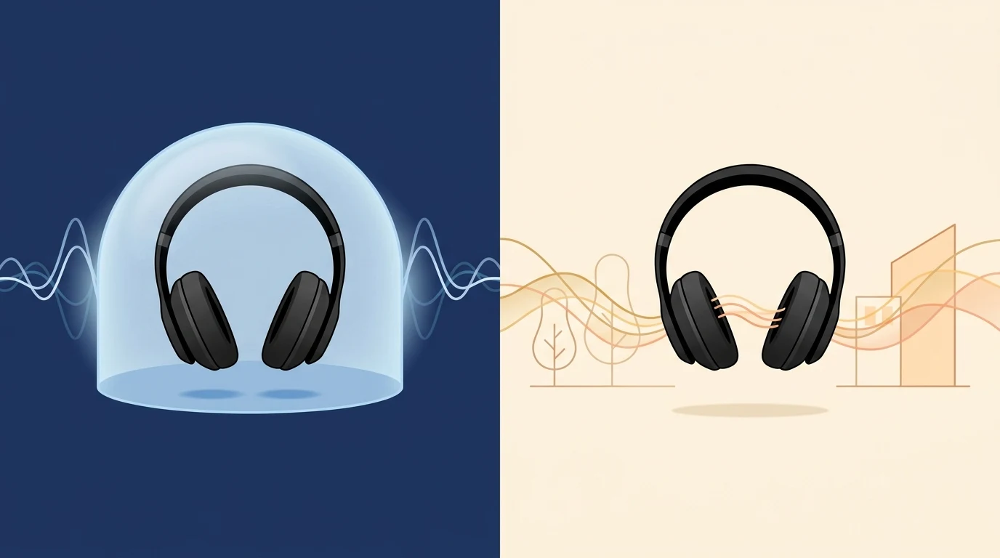

# BoseSwitch


**在 Windows 和 Mac 的 Chrome 里，一键决定 Bose 耳机连哪台电脑、切换降噪模式，不用再拿起手机。**

> An unofficial Chrome extension + tiny local helper that lets you switch a Bose QC45 / QC35 II between computers and change its noise-cancelling mode from Windows or macOS, without the phone app. Chinese UI.

本项目与 Bose 公司无关，不是官方产品。详见文末「免责声明」。

---

## 它解决什么问题

如果你同时用手机、Windows 电脑和 Mac，大概遇到过这些麻烦：

- 耳机一开机，先自动连上手机，电脑永远排第二。
- 想看当前是什么降噪模式、想切换，只能打开手机上的 Bose app。
- 想把耳机从 Windows 换到 Mac，要么拿手机操作，要么在两台电脑的蓝牙设置里反复断开、重连。

BoseSwitch 把这些操作搬到电脑上：点一下浏览器工具栏的图标，就能看到耳机状态，并直接操作。


## 功能



- **查看状态**：耳机名称、型号、电量、当前降噪模式。
- **切换降噪**：QC45 在「安静 / 感知」之间切换；QC35 II 在「强 / 弱」之间切换。
- **管理连接**：列出耳机记住的所有设备，并标出谁在线。可以：
  - 断开某台设备，比如把手机踢下线。
  - 让耳机去连某台离线设备。
- **拉到本机**：让耳机把音频连到当前这台电脑。
- **让出耳机**：断开当前电脑，空出名额给另一台电脑。
- **多副耳机**：电脑上配对了几副 Bose 耳机，就能在窗口顶部切换。
- **中文提示**：名额已满、连不上、小助手没装等情况，都给出中文说明。

<br clear="right">



## 支持的设备与系统

| 耳机 | 产品 ID | 降噪模式 | 验证情况 |
|---|---|---|---|
| QuietComfort 45 | `0x4039` | 安静 / 感知 | Windows 10、macOS 真机验证 |
| QuietComfort 35 II | `0x4020` | 强 / 弱 | macOS 真机验证 |
| 其他 Bose 耳机 | — | 不显示 | 可能能看电量、管理连接，未验证 |

- **系统**：Windows 10/11、macOS。需要 Chrome 浏览器。
- **Python**：Windows 需要 Python 3.9 以上；macOS 用系统自带的 Python 3.9 即可。
- **AirPods 不支持**：在 Windows 上切换 AirPods 降噪，必须装测试签名驱动并关闭安全启动。在 Mac 上，系统控制中心已经提供这些功能。

## 工作原理


- Bose 耳机通过一条蓝牙串口通道接收控制命令，协议叫 BMAP。
- 这条通道没有在蓝牙服务列表（SDP）里公布，所以 Chrome 自带的 Web Serial 连不上它。
- 因此每台电脑上装一个很小的 Python「小助手」，它只负责收发原始字节。
- 所有协议逻辑都在扩展里：打包、解析、型号识别、请求排队。

协议细节见 [docs/PROTOCOL.md](docs/PROTOCOL.md)。

## 安装

两台电脑分别安装：先装小助手，再装扩展。

### Windows

1. 安装 [Python 3.9+](https://www.python.org/downloads/)。安装时勾选「Add python.exe to PATH」。
2. 下载本仓库，进入项目文件夹，运行：
   ```
   python helper\install_windows.py
   ```
   脚本只写当前用户的注册表，不需要管理员权限。看到「已安装」即可。
3. 打开 Chrome 的 `chrome://extensions`，打开右上角「开发者模式」，点「加载已解压的扩展程序」，选择 `extension` 文件夹。
4. 确认耳机已经和这台电脑配对过（Windows 设置 → 蓝牙）。

### macOS

1. 下载本仓库，在「终端」里运行：
   ```
   sh helper/install_mac.sh
   ```
   脚本会做 3 件事：创建一个独立的 Python 环境；装好蓝牙组件 PyObjC 11.1；最后自动跑一次自检。如果系统询问「终端」能否使用蓝牙，点「允许」。
2. 在 Chrome 里加载 `extension` 文件夹，方法同 Windows 第 3 步。
3. 如果窗口里提示没有蓝牙权限：打开「系统设置 → 隐私与安全性 → 蓝牙」，允许 Google Chrome。

> 扩展的 manifest 里固定了公钥，所以每台电脑上的扩展 ID 都是 `fnanijmlhmchfapoonnmedlmandfcoje`，小助手只接受这个 ID 的连接。

## 使用

1. 点 Chrome 工具栏里的 BoseSwitch 图标，会打开一个小窗口。
2. 窗口会自动连上耳机，并显示状态。

**把耳机从 Windows 换到 Mac，分两步：**

1. 在 Windows 的窗口里点「**让出耳机**」。
2. 在 Mac 的窗口里点「**拉到本机**」。

整个过程手机保持连接，不受影响。

**需要知道的规则：**

- 耳机最多同时连 2 台设备。两个名额都满时，第三台设备连控制通道都打不开，也不会自动挤掉别人。这和 Bose 官方 app 的行为一致。遇到这种情况，在已连接的设备上点「让出耳机」，或者断开手机。
- 「让出耳机」会立刻切断当前电脑和耳机的连接，所以交接只能分两步做。
- 在 Mac 上，打开窗口时系统会顺带把音频连过来，相当于自动「拉到本机」。Windows 只连控制通道，不动音频。
- 同一台电脑同一时间只能有一个程序占用耳机的控制通道。窗口开着时，再运行自检会失败。

## 常见问题

**窗口提示「没有找到小助手」**
小助手还没装，或者装完后没有刷新扩展。运行安装脚本，然后在 `chrome://extensions` 里刷新 BoseSwitch。

**窗口提示「连不上耳机」**
可能有两个原因：
- 耳机没开机，或者不在附近。
- 两个名额都被其他设备占着。请在已连接的设备上让出耳机。

**怎么单独测试小助手**
关掉 BoseSwitch 窗口，运行下面的命令，能看到「电量 xx%」就说明小助手和耳机通信正常：
```
python helper/host.py --selftest <耳机名称的一部分>
```
在 Mac 上，用安装目录里的 Python 运行：
```
"$HOME/Library/Application Support/BoseSwitch/venv/bin/python" -I "$HOME/Library/Application Support/BoseSwitch/host.py" --selftest <耳机名称>
```

**日志在哪**
- Windows：`%LOCALAPPDATA%\BoseSwitch\helper.log`
- macOS：`~/Library/Logs/BoseSwitch/helper.log`

**卸载**
- Windows：运行 `python helper\install_windows.py --uninstall`。
- macOS：运行 `sh helper/install_mac.sh --uninstall`。
- 最后在 Chrome 里移除扩展。

## 开发

```
extension/          Chrome 扩展（Manifest V3）
  background.js     点图标打开独立窗口（同一时间只保留一个）
  popup.*           主界面
  diag.*            诊断页：经小助手收发原始 BMAP 包
  lib/bmap.js       BMAP 编解码 + 型号表
  lib/headset.js    会话层：请求和回包配对、排队、超时、错误码、推送
  lib/native.js     Native Messaging 连接器
  lib/messages.js   错误 → 中文提示
  lib/window.js     独立窗口管理
helper/             本机小助手（Python 标准库；macOS 另需 PyObjC）
  host.py           主程序，支持 --selftest
  mac_bt.py         macOS 蓝牙层（IOBluetooth）
  install_*.py/.sh  安装脚本
test/               扩展单元测试（node --test）
fixtures/           在真机上录到的收发字节（已匿名化），测试数据来源
tools/              Windows 上的协议探针脚本
docs/PROTOCOL.md    已验证的协议笔记
```

运行测试：

```
npm test                                   # 扩展，Node 20+
python -m unittest discover -s helper      # 小助手
```

测试数据都来自真机录音，没有编造的字节。蓝牙地址和设备名已替换成虚构值，长度保持不变。

**安全提醒**：BMAP 里有固件更新等危险功能。只发送含义已知的命令，不要循环扫描频道，也不要碰 RFCOMM 24 号频道。

## 致谢

协议研究参考了这些开源项目：

- [Denton-L/based-connect](https://github.com/Denton-L/based-connect)：QC35 的设备管理命令
- [aaronsb/bosectl](https://github.com/aaronsb/bosectl)：QC45 型号配置、macOS 蓝牙接入方式
- [pmaxhogan/bosebridge](https://github.com/pmaxhogan/bosebridge)：设备连接 / 断开命令的格式
- [kaledcorona/bose-rfcomm](https://github.com/kaledcorona/bose-rfcomm)：协议规范与安全警告
- [xinutec/volume](https://github.com/xinutec/volume)：QC45 / QC35 的降噪命令

## 免责声明

- 本项目是个人开发的非官方工具，与 Bose Corporation 没有任何关联，也没有得到其认可。
- Bose、QuietComfort 是 Bose Corporation 的商标。文中出现只为说明兼容性。
- 本工具通过逆向得到的协议和耳机通信。请自行承担使用风险。

## 许可证

[MIT](LICENSE)
